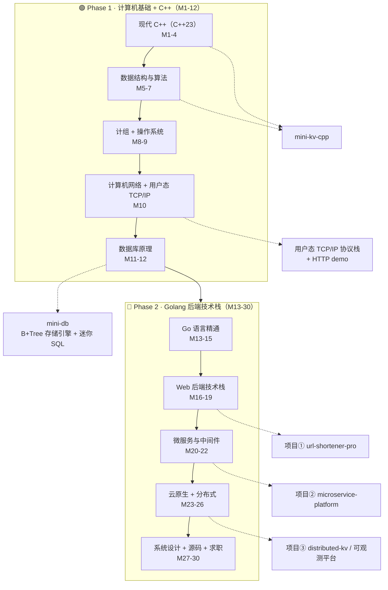

# 后端工程师：2.5 年学习计划



---

> 总时长 30 个月：**Phase 1 计算机基础 + C++（M1–M12，12 个月）** → **Phase 2 Golang 后端技术栈（M13–M30，18 个月）**。
> 全程**项目实践驱动**：每个月都有可运行、可展示的交付物；理论服务于项目，项目反过来逼出理论的深度。

## 仓库结构

本仓库是 2.5 年学习的**总控仓库**（计划 + 笔记 + 刷题 + 日志）；6 个主线项目各自独立建仓，`projects/README.md` 只做索引。

```
backend/
├── README.md                     # 2.5 年计划（总入口）
├── docs/
│   ├── plan/
│   │   └── adjustments.md        # 计划变更日志（延期、节奏调整、目标修订）
│   ├── resources.md              # 资源清单：书/课程/链接 + 阅读状态跟踪
│   └── templates/
│       ├── weekly.md             # 周记模板（本周产出 / 卡点 / 下周计划）
│       ├── monthly-review.md     # 月度复盘模板
│       └── self-check.md         # 月度自检清单（可勾选版）
├── notes/                        # 技术笔记，按计划的 11 个模块组织
│   ├── 01-cpp/                   # M1–M4
│   ├── 02-dsa/                   # M5–M7
│   ├── 03-computer-organization/ # M8
│   ├── 04-os/                    # M9
│   ├── 05-network/               # M10
│   ├── 06-database/              # M11–M12
│   ├── 07-go/                    # M13–M15
│   ├── 08-web/                   # M16–M19
│   ├── 09-microservices/         # M20–M22
│   ├── 10-distributed/           # M23–M26
│   └── 11-system-design/         # M27–M28
├── algorithms/                   # 刷题线（全程不断）
│   ├── README.md                 # 刷题统计表：进度、错题重做记录
│   ├── solutions/                # 题解，按专题分目录（文件名：题号-名称.语言）
│   │   ├── array-linkedlist/  hash/  two-pointers/  stack-queue/
│   │   ├── binary-tree/  heap/  binary-search/  string/
│   │   └── graph/  dp/  backtracking/  greedy/
│   └── templates/                # 手撕模板：二分、图、DP、链表骨架
├── logs/
│   ├── weekly/                   # 2026-W46.md ...（每周一份）
│   └── monthly/                  # 2026-11.md ...（月度复盘，对应 git tag）
├── projects/
│   └── README.md                 # 6 个主线项目索引：链接 + 状态 + 收官标准
├── blog/                         # 对外输出文章（草稿 → 成稿）
└── interview/                    # M29–M30 使用
    ├── qbank/                    # 面试题库：每题 = 原理 + 项目佐证
    └── system-design/            # 系统设计文档 5+ 篇
```

## 0. 总原则

1. **项目驱动，不是课程驱动**。每学一个知识点，必须在项目里用一次；用不上的知识先不学。
2. **输出倒逼输入**。每个月产出：代码仓库（有 tag）+ 一篇技术笔记/博客 + 周记（每周）。
3. **两条永不间断的线**：
   - 算法线：每周 3–5 道 LeetCode（全程约 500 题），从 M5 正式开始、贯穿到 M30。
   - 英语线：官方文档、论文、源码一律读英文；每周精读 1 篇英文技术文章。
4. **时间预算**（在职状态下的可持续节奏）：
   - 工作日：2h/天（1h 理论阅读 + 1h 编码）
   - 周末：5h/天（项目为主）
   - 合计 ≈ **20h/周**，每月 ≈ 80h
5. **验收标准**：每月底做一次自检（见「每月自检清单」），不合格不带病推进——降速补课，宁可延后 1 个月，不留下理解债。
6. **C 语言不单独安排学习时间**：C++ 已覆盖绝大部分 C 语法结构；后续项目用到 C 时直接查文档（K&R / man 手册），不为其分配专门周。

---

## Phase 1 · 计算机基础 + C++（M1–M12）

### 阶段目标

- 精通现代 C++，以 **C++23** 为基线标准（重点），理解从源码到二进制的完整链路。
- 手写核心数据结构与算法，复杂度分析成为本能。
- 吃透 CSAPP 级别的系统观：缓存、并发、虚拟内存、I/O。
- 理解数据库内核：索引、事务、日志、恢复。
- **三个主线项目**（都放进 GitHub，写好 README + 设计文档）：
  1. **mini-kv-cpp** —— C++ 实现的持久化 KV 存储（贯穿 M2–M7）
  2. **user-tcpip** —— 用户态 TCP/IP 协议栈 + HTTP demo（M10）
  3. **mini-db** —— B+Tree 存储引擎 + 迷你 SQL 层（M11–M12）

### 月度安排

#### M1 · C++ 基础语法与底层工具链（快节奏打底）

- C++23 基础语法速通（覆盖绝大部分 C 语法结构）：类型/控制流/函数、指针与数组、字符串（C 字符串 + `std::string`/`std::string_view`）、结构体、引用 vs 指针、函数重载/默认参数、命名空间、`auto` 与结构化绑定
- 动态内存：`new/delete`、常见内存错误；valgrind / ASan（`-fsanitize=address`）
- 工具链：g++ 15（**基线 `-std=c++23`**，编译链接全流程 `-E -S -c`、静态/动态库）、GDB（断点、watch、backtrace、core dump）、Makefile/CMake 入门
- Linux 基础：shell、文件权限、进程查看、`/proc`
- **交付**：C++ 基础练习集（字符串处理用上 `std::string_view`/`std::format` + `vec` 类 + 单元测试）；GDB 实战调试记录（4 个刻意 bug 定位成文）；工具链产物观察笔记
- 阅读：《C++ Primer》(第 5 版) 第 1–4 章 + Beej's Network Programming 前 2 章（概念预热）

#### M2 · C++ 核心（面向对象 + 资源管理）

- 类与对象、构造/析构、拷贝控制（三/五法则、`= default`/`= delete`）、运算符重载；RAII——本阶段最重要的思想；异常安全；`const` 体系、`static_cast` 系列
- STL 第一遍：`vector/deque/list/map/unordered_map` 的使用与复杂度
- **交付**：**mini-kv-cpp 立项**——实现 `get/set/del` 的内存版 KV（哈希表 + 链地址法），带 Benchmark 脚本
- 阅读：《C++ Primer》(第 5 版) 第 5–13 章

#### M3 · 现代 C++（C++11→17 演进 + C++20/23 新标准）

- 右值引用、移动语义、完美转发；智能指针（`unique_ptr/shared_ptr/weak_ptr`）
- 模板进阶：函数/类模板、特化、SFINAE → **concepts**、变参模板
- **C++20/23 新特性**：`ranges`、协程（coroutines）、modules、`consteval/constinit`、三路比较 `<=>`、`std::format`/`std::print`/`std::println`、`std::expected`、`std::span`/`mdspan`、`flat_map/flat_set`
- STL 源码选读：`vector` 扩容、`unordered_map`、迭代器与 allocator 概览
- lambda、`std::function`、`optional/variant/any`
- **交付**：mini-kv-cpp v0.2——自实现跳表（skip list）作为索引 + 迭代器接口；给 KV 写 C++ 模板版序列化器（用 `std::format`）；**用 ranges/concepts 重构一处接口**
- 阅读：《Effective Modern C++》条款 1–30；《C++20 - The Complete Guide》+《C++23 - The Complete Guide》(Josuttis) 选读；cppreference 养成查阅习惯（以 C++23 为准）

#### M4 · C++ 并发 + 工程化

- 内存模型与原子操作（`atomic`、memory order 概念级）、互斥锁、条件变量、`std::thread/async/future`；C++20 并发原语：`std::jthread`/`stop_token`、`semaphore`、`latch/barrier`
- 死锁四条件、锁的粒度与性能；无锁结构概念（不深入实现）
- CMake 工程化：多目录、第三方库引入、GoogleTest、sanitizer（ASan/TSan）
- **交付**：mini-kv-cpp v0.3——**WAL（预写日志）+ 崩溃恢复** + 并发读写（读写锁）；CI（GitHub Actions 编译 + 测试 + sanitizer）
- 阅读：《C++ Concurrency in Action》第 1–7 章（基于 C++11/17，C++20 新原语对照 cppreference）

#### M5 · 数据结构（一）：线性结构 + 排序

- 复杂度分析（摊还分析入门）、数组/链表/栈/队列/双端队列
- 哈希表：冲突解决、扩容、一致性哈希（概念）
- 排序：快排/归并/堆排/基数排序；比较器与稳定性
- LeetCode 启动：数组/链表/哈希/双指针/滑动窗口专题
- **交付**：自研容器库 `my-stl`（`list/stack/queue/hash_map`）对比 STL 的 benchmark；LeetCode 20 题

#### M6 · 数据结构（二）：树与堆

- BST、AVL/红黑树（原理与旋转，会手写 AVL）、堆与优先队列、Trie、并查集、跳表复习
- 线段树/树状数组（至少各写一遍）
- **交付**：mini-kv-cpp v0.4——把索引替换为自研 **B+ 树**（分裂/合并/范围查询）；LRU/LFU 缓存两种实现；LeetCode 25 题（树/堆专题）

#### M7 · 算法设计 + 图论

- 图：BFS/DFS、拓扑排序、最短路（Dijkstra/Bellman-Ford）、最小生成树、并查集应用
- 动态规划：背包、区间 DP、状态机 DP；贪心证明思路；回溯；分治
- 字符串：KMP、Trie 应用
- **交付**：mini-kv-cpp v1.0 **发布**（性能报告：单线程 QPS、并发吞吐、崩溃恢复正确性测试）；LeetCode 35 题（DP/图专题）；一篇「我如何设计一个 KV 存储」长文

#### M8 · 计算机组成原理

- 数据表示与运算、指令集体系（以 RISC-V 为主线看汇编，对照 x86-64）
- CPU：流水线、冒险与转发、缓存层次（重点：cache 局部性、cache line 伪共享）
- 内存层次、虚拟内存与 MMU、总线、DMA、I/O（中断 vs 轮询）
- **实践**：写汇编小函数（递归/字符串拷贝）用 `objdump` 反推；做 cache 局部性实验（矩阵遍历顺序对耗时的影响，画出数据）
- 阅读：《深入理解计算机系统》(CSAPP) 第 1–6、10 章；配套 CMU 15-213 的 lab（Bomb Lab / Cache Lab 至少做两个）

#### M9 · 操作系统原理 + 系统编程

- 进程/线程、调度算法、上下文切换；并发原语（信号量、互斥锁、管程）
- 死锁、内存管理（分段/分页/页面置换）、文件系统（inode、日志式 FS）
- Linux 系统编程：进程控制、信号、文件 I/O、mmap、多路复用（select/poll/epoll）
- **实践**：实现迷你**协程/用户态调度器**（ucontext 或手写汇编切换）；用 `strace/perf/top` 解释一个真实程序的行为
- 阅读：《OSTEP》（免费）重点章节 + APUE 选读（进程/信号/线程/IO）

#### M10 · 计算机网络 + 用户态协议栈

- 分层模型、以太网帧、ARP、IP、ICMP、TCP（三次握手/四次挥手、滑动窗口、拥塞控制）、UDP、DNS、HTTP/1.1–2、TLS 概念
- socket 编程全流程
- **项目 user-tcpip**：在 TUN/TAP 或原始套接字上实现 ARP + IP + ICMP + 简化 TCP（握手、seq/ack、超时重传）+ 一个能响应 curl 的 HTTP demo
- 阅读：《计算机网络：自顶向下方法》第 1–4 章 + 《TCP/IP 详解 卷1》选读（TCP 章节）

#### M11 · 数据库原理（一）：存储与索引

- 关系模型、SQL 语法（窗口函数、CTE）、范式与反范式
- 存储引擎：页、槽页、B+ 树索引、聚簇/非聚簇索引、覆盖索引、回表
- 查询执行：火山模型、连接算法（Nested Loop/Hash/Merge Join）、查询优化器概览
- **项目 mini-db 启动**：B+ 树存储引擎（页管理、缓冲池、LRU 替换）+ 记录序列化
- 阅读：《MySQL 是怎样运行的》(小孩子) 全书 + CMU 15-445 讲义/Bustub Lab（Project #1/#2）

#### M12 · 数据库原理（二）：事务 + 落地

- 事务 ACID、隔离级别、MVCC、锁（两阶段锁）、死锁检测
- 日志与恢复：WAL、ARIES 思想、检查点；分布式事务概念（2PC）
- MySQL 实战：索引调优、`EXPLAIN`、慢查询、主从复制、分库分表概念；Redis 五大结构的底层实现（SDS、跳表、字典）
- **项目 mini-db 收官**：MVCC 或简单两阶段锁 + WAL 崩溃恢复 + 迷你 SQL 解析（`CREATE/INSERT/SELECT WHERE`）；跑通 SQL 逻辑测试集
- **Phase 1 毕业验收**：三个项目代码整洁、文档完整、演示视频/动图；做一次全年复盘长文

---

## Phase 2 · Golang 后端技术栈（M13–M30）

### 阶段目标

- Go 语言与 runtime 达到「面试不怕问原理、线上不怕查性能」的水平。
- 完整走通：Web 服务 → 微服务 → 云原生/分布式 → 生产级系统设计。
- **三个主线项目**：
  1. **url-shortener-pro** —— 短链服务（M16–M19，从单体演进到高并发版）
  2. **microservice-platform** —— 微服务平台（M20–M22）
  3. **distributed-kv / observability-platform** —— 分布式 KV（Raft）或可观测平台（M23–M26）

### 月度安排

#### M13 · Go 语言核心

- 语法与类型系统：接口（隐式实现、组合）、结构体与组合、错误处理哲学、defer/panic/recover
- 泛型（类型约束）、反射（会用即可）、包管理（go mod）
- 工具链：`go test`/`go vet`/`pprof`/`trace`、交叉编译、内嵌资源
- **交付**：用 Go 重写 mini-kv 的网络版（TCP 协议 + 并发 handler），作为「Go 版 KV」的起点；LeetCode 用 Go 重写 20 题

#### M14 · Go 并发编程

- goroutine 调度模型（GMP）、channel 语义与模式（fan-in/out、pipeline、worker pool）
- `sync` 包全家桶、`context` 传播与超时取消、`errgroup`
- 并发陷阱：数据竞争、channel 泄漏、`-race` 实战
- **交付**：并发爬虫/下载器（限速、断点续传、取消）+ 数据竞争排查报告；读《Go 专家编程》并发章节

#### M15 · Go 进阶 + Runtime

- 内存分配（tcmalloc 思路、逃逸分析）、GC（三色标记、调优 GOGC）
- map/slice/channel 底层结构（hmap、sudog、环形缓冲）、`sync.Pool`
- 性能分析实战：pprof 火焰图、基准测试、常见优化手段
- **交付**：对 Go 版 KV 做压测 + 火焰图优化，写出「性能优化实录」；读《Go 语言高级编程》选章 + Go 官方博客（GC、Scheduler 两篇）

#### M16 · Web 后端基础

- `net/http` 原理（Handler、中间件、路由）、Gin 或 Echo、参数校验、优雅退出
- 分层架构：handler/service/repository、依赖注入、配置管理（viper）、日志（zap/zerolog）
- 单元测试与 mock（gomock/testify）
- **交付**：**url-shortener-pro 立项**——短链生成（发号器：自增/雪花）、302 跳转、过期时间、基础限流

#### M17 · 存储层：MySQL + Redis

- GORM/sqlx、连接池、事务与锁的正确用法、慢查询与索引优化
- Redis：五大结构实战、持久化、缓存三大问题（穿透/击穿/雪崩）、分布式锁（Redlock 之争）、Lua 脚本
- **交付**：短链服务加缓存层（Cache Aside + 布隆过滤器）+ MySQL 索引调优报告；做一次缓存与 DB 一致性的实验并写文

#### M18 · 消息队列 + 认证 + 服务可靠性

- Kafka（分区、副本、消费组、幂等/Exactly-once 思想）或 RocketMQ/RabbitMQ 选一
- JWT/OAuth2、RBAC 权限、接口幂等（唯一键 + 去重表）
- 限流（令牌桶）、熔断降级（gobreaker）、超时与重试设计
- **交付**：短链服务接入 MQ（点击日志异步入库 + 实时统计）+ 认证鉴权；完成一次故障演练（依赖超时/DB 抖动）

#### M19 · 容器化 + 短链项目收官

- Docker：镜像构建（多阶段）、Compose、网络与存储；Dockerfile 最佳实践
- Makefile/脚本化开发、环境隔离、配置与密钥管理
- 压测：wrk/vegeta、基准报告、瓶颈分析（连接池/锁/GC）
- **交付**：url-shortener-pro **v1.0 发布**：Docker Compose 一键起（app + MySQL + Redis + MQ），压测报告 + 架构文档 + 设计复盘

#### M20 · 微服务基础

- gRPC + Protobuf（流式、拦截器、错误码）、服务契约管理
- 服务注册与发现（etcd/Consul/Nacos）、客户端负载均衡、健康检查
- 微服务拆分原则（DDD 战术建模入门：限界上下文、聚合）
- **交付**：**microservice-platform 立项**——拆出 用户/订单/商品 三个服务 + gRPC 通信 + 网关（路由、鉴权）

#### M21 · 微服务治理

- 分布式事务：Saga/本地消息表/TCC 选型与实现；分布式 ID（雪花、Leaf 思路）
- 配置中心（etcd/apollo 思路）、灰度发布、蓝绿发布
- 可观测性接入：结构化日志、TraceID 传播、OpenTelemetry 基础
- **交付**：平台接入分布式事务（订单-库存-支付链路）+ 全链路 TraceID + 配置热更新

#### M22 · 微服务可靠性 + 平台收官

- 熔断/限流/降级体系化（gRPC 拦截器统一实现）、超时预算、重试风暴防护
- 流量网关进阶（认证、限流、灰度）、混沌工程入门（随机注入故障）
- **交付**：microservice-platform **v1.0 发布**：完整链路（下单→扣库存→支付→消息通知）+ 压测 + 故障注入报告 + 架构文档；读《数据密集型应用系统设计》(DDIA) 前 9 章

#### M23 · 分布式理论 + 共识

- CAP/BASE、一致性模型、Paxos/Raft（论文 + Raft 可视化 + 逐图推演）
- etcd 架构与 raft 实现选读；分布式时间（向量时钟、TrueTime 思想）
- **交付**：手写 **Raft 共识库**（选举 + 日志复制，先单机模拟多节点），通过 Raft 论文的场景自测用例

#### M24 · 分布式存储

- 分布式 KV/存储设计：分片（一致性哈希）、副本、读写 quorum、故障恢复
- 分布式表/分库分表、分布式事务在存储层的应用；对象存储概念
- **交付**：**distributed-kv 立项**——Raft 库 + 分片路由 + 客户端 SDK，节点宕机自动切换，跑通故障恢复用例

#### M25 · 云原生

- Kubernetes：Pod/Deployment/Service/Ingress/ConfigMap、资源与调度、探针
- Helm、Operator 概念、K8s 网络与存储基础
- CI/CD：GitHub Actions/GitLab CI、镜像仓库、自动化测试与部署流水线
- **交付**：把 distributed-kv（或平台）部署上 K8s（Helm chart + 滚动更新 + 探针），CI/CD 全自动发布

#### M26 · 可观测性 + 性能

- Prometheus + Grafana（指标设计：RED/USE）、告警规则
- ELK/Loki 日志体系、OpenTelemetry 全链路追踪（Jaeger/Tempo）
- Go 性能调优实战：GC、锁、内存、网络；容量规划与压测体系（全链路压测思路）
- **交付**：可观测三件套落地 + Grafana 看板 + 告警演练；一篇容量评估与性能调优长文。**项目③ 收官**（distributed-kv 或 observability-platform 二选一做深）

#### M27 · 系统设计（一）

- 方法论：需求澄清→估算→API→数据模型→高层架构→深入→权衡
- 案例精讲：短链、秒杀、IM 消息、Feed 流、网盘、支付系统
- **交付**：系统设计文档 5 篇（每篇含估算、架构图、故障与扩展方案）；练习白板讲解（录音回听）

#### M28 · 源码与原理深挖

- Go runtime：调度器、GC、chan/map 源码走读
- 框架源码：Gin、GORM、etcd/raft、grpc-go 选读；中间件原理：Redis、MySQL、Kafka 各挑一个模块（Redis 持久化/主从、MySQL redo log/MVCC、Kafka ISR）
- **交付**：源码阅读笔记 6 篇 + 1 次技术分享（录视频）

#### M29 · 面试准备（一）：八股 + 算法

- 专题复习：Go 语言、MySQL、Redis、MQ、操作系统、网络、分布式（结合自己的项目组织答案，不背题）
- LeetCode 高频 150 题复盘（重点：手撕不出 bug）；系统设计再练 5 题
- **交付**：自建面试题库（每题 = 原理 + 自己的项目佐证）；模拟面试 ≥ 4 次

#### M30 · 面试准备（二）+ 收官

- 简历最终版（三个项目量化：QPS、可用性、优化幅度）；项目深挖演练（为什么这么设计、踩过什么坑、如何改进）
- 查漏补缺 + 开源贡献（给 Go 生态提交 1–2 个 PR 更佳）
- **最终交付**：GitHub 学习主页（项目索引 + 全年复盘长文）；进入投递/晋升冲刺

---

## 主线项目一览

| # | 项目 | 时间 | 技术点 | 收官标准 |
|---|------|------|--------|----------|
| 1 | mini-kv-cpp | M1–M7 | C++23、跳表/B+树、WAL、并发、CMake/CI | v1.0 tag + 压测/恢复测试报告 |
| 2 | user-tcpip | M10 | socket、TCP 状态机、协议实现 | curl 能访问自研 HTTP demo |
| 3 | mini-db | M11–M12 | B+树、缓冲池、WAL/MVCC、SQL 解析 | 跑通 SQL 逻辑测试集 |
| 4 | url-shortener-pro | M16–M19 | Go、MySQL、Redis、MQ、Docker | Compose 一键起 + 压测报告 |
| 5 | microservice-platform | M20–M22 | gRPC、注册发现、分布式事务、链路追踪 | 故障注入报告 + 完整业务链路 |
| 6 | distributed-kv / observability | M23–M26 | Raft、分片、K8s、可观测 | 节点宕机自动切换 / 三件套落地 |

## 贯穿性任务（全程）

- **LeetCode**：M5 起每周 3–5 题（周末集中 2h + 碎片时间），按专题推进，累计约 500 题；每题写清复杂度与至少一种 follow-up。
- **周记**：每周日 30 分钟——本周做了什么、卡在哪、下周计划；每月最后一天写月度复盘并打 tag。
- **技术输出**：每月至少 1 篇博客/笔记（项目复盘、源码解析、原理推演）。

## 每月自检清单（验收标准）

1. 这个月的交付物能否在 5 分钟内演示给别人看？
2. 能否不看资料给同事讲清楚本月 3 个核心概念（画图讲）？
3. 代码是否进了 CI、测试是否覆盖核心路径？
4. LeetCode 是否按量完成、错题是否重做？
5. 时间投入是否 ≥ 70h？不足则下月排期自动顺延。

## 核心资源

**C++**（基线 C++23）：《C++ Primer》（基础，止于 C++11）→《Effective Modern C++》→《C++20 - The Complete Guide》+《C++23 - The Complete Guide》(Josuttis)→《C++ Concurrency in Action》；cppreference（以 C++23 为准）；《STL 源码剖析》选读；C 语言不单独安排学习，用到时查 K&R / man 手册
**算法**：LeetCode（Hot 100 → 剑指 Offer → 专题）；《算法（第 4 版）》；《Hello 算法》；《算法导论》工具书
**计组**：《深入理解计算机系统》(CSAPP) + CMU 15-213 Lab
**操作系统**：《OSTEP》+ MIT 6.S081 (xv6) 实验（至少做 2 个）；APUE 选读
**网络**：《计算机网络：自顶向下方法》+《TCP/IP 详解 卷1》选读 + Beej's Socket Programming
**数据库**：《MySQL 是怎样运行的》+ CMU 15-445（Bustub）+ 《数据库系统内幕》+ 《Redis 设计与实现》
**Go**：《Go 程序设计语言》→《Go 专家编程》→《Go 语言高级编程》；Go 官方 blog（Scheduler/GC 等）
**分布式/架构**：《数据密集型应用系统设计》(DDIA) + Raft 论文与可视化 +《System Design Interview》(Alex Xu) + 《大型网站技术架构》

## 风险与预案

- **时间不足**：优先砍「阅读量」，永不砍「项目交付」；每季度允许 1 个月的弹性缓冲（顺延而非压缩）。
- **某月延期**：允许最多延 1 个月，连续两次延期则重新评估目标速度，调低月度目标。
- **贪多嚼不烂**：每个技术点以「能在项目里用出来」为准；源码/论文类内容做不到就先用起来，M28 集中补。
- **倦怠期**（约 M8、M19、M26 附近常见）：切换为「输出模式」（写文/录分享/做演讲），降低新知识输入量。
